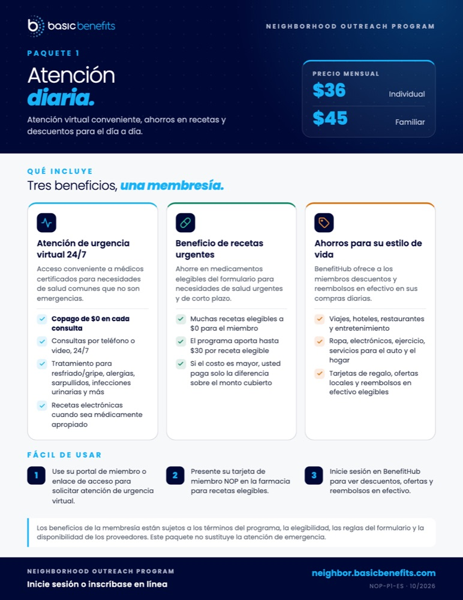
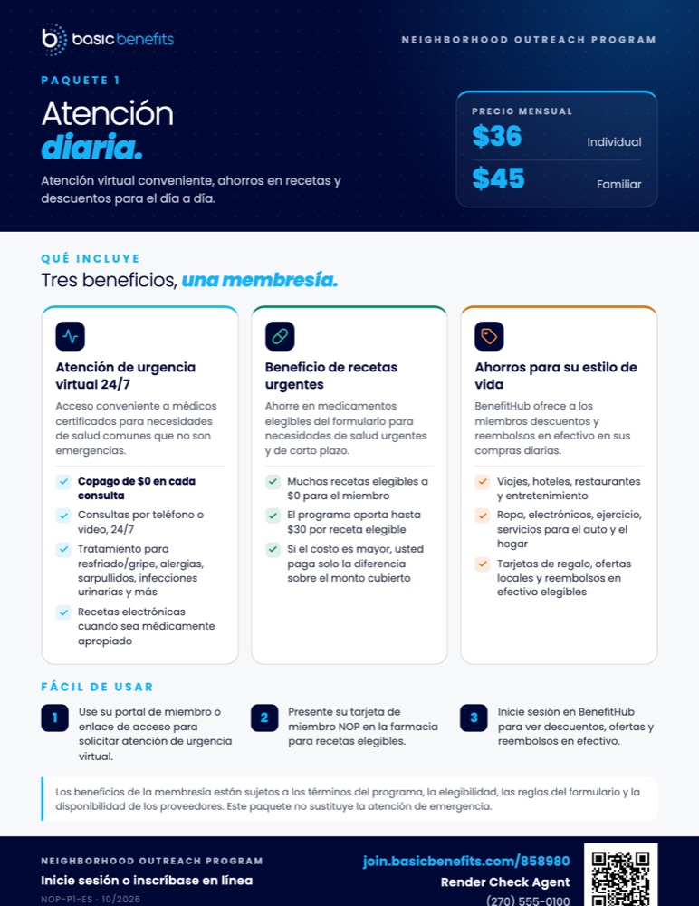
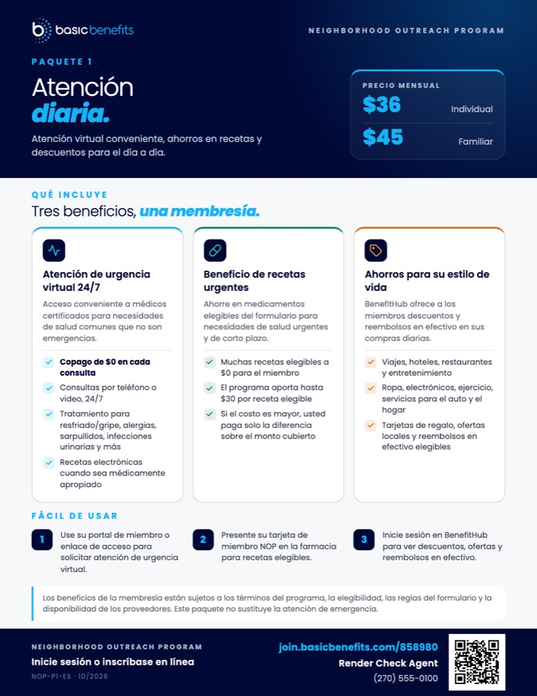
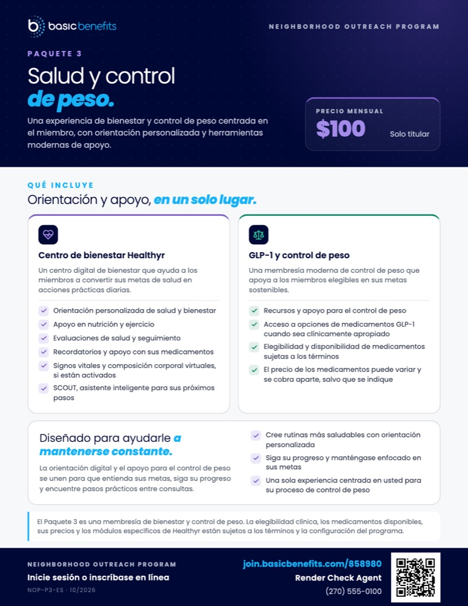
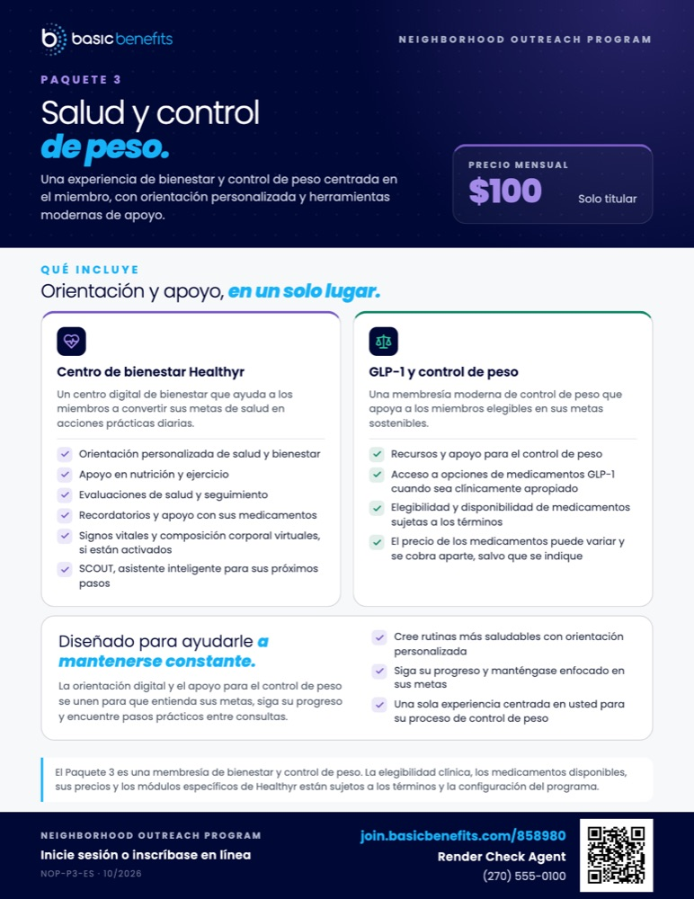

# Spanish flyers P1 and P3: the agent's details don't fit (options for sign-off)

> **Superseded 12 November 2026** by the spacing proposal on branch
> `nop-v2-spacing` (`SPACING` in `lib/enterprise/nop-render/footer-placement.ts`):
> spacing only, for Spanish P1, and P2 and P3 in both languages, with at least
> 0.05in to spare above the footer and 0.08in between blocks on every page.

12 November 2026. Measurements are from the final flyers as supplied (10/2026),
at Letter size; the bleed versions behave the same way. Sizes are given in
inches at print size.

## What's wrong

Every flyer gets the agent's details at the bottom: the enrollment link, name,
phone and QR code, in the bottom strip, as approved. That makes the bottom
strip **0.29 in taller** on every flyer. On most flyers the content above has
room to spare, so nothing else changes.

On two Spanish flyers it doesn't, because the Spanish wording is longer:

| Flyer | Pushed past the bottom of the page by |
|---|---|
| P1 Everyday Care, Spanish (with and without prices) | **0.23 in**: the agent's phone number and the bottom of the QR code are cut off |
| P3 Health & Weight Management, Spanish (with and without prices) | **0.02 in**: just over the edge |

All English flyers and both P2 versions fit. Our system checks every flyer
before anyone can download it and refuses these four, so **no faulty flyer has
been or can be made**. Spanish flyers aren't available to agents, and can't be
switched on until all six Spanish flyers fit.

Why the Spanish versions are taller:

- **P1 Spanish:** the three benefit cards are 1.06 in taller than in English.
  The first card ("Atención de urgencia virtual 24/7") is the longest and sets
  the height of all three. The "Fácil de usar" steps are 0.18 in taller, because
  step 1 wraps onto a fourth line ("virtual.").
- **P3 Spanish:** the "Centro de bienestar Healthyr" card is 0.18 in taller than
  in English.

**P1 Spanish today** (left: as supplied, without the agent's details; right:
with them, cut off at the bottom):

 

## Option 1: tighten the spacing between sections (recommended)

This is the same kind of change you already approved for P2 and P3. Only the
empty space between the page's sections gets smaller:

| Space | Now | Option 1 |
|---|---|---|
| Above "Qué incluye" (below the dark header) | 0.23 in | 0.17 in |
| Between sections (benefit cards, "Fácil de usar", disclaimer) | 0.17 in (P3: 0.125 in, approved) | 0.10 in |
| Below the disclaimer (above the bottom strip) | 0.19 in (P3: 0.125 in, approved) | 0.125 in |

No text, image, price, card or box changes size, and nothing moves sideways.
The headings and cards move up by 0.06 to 0.19 in. The disclaimer stays
directly above the bottom strip, as it is now. In total this gives back
0.31 in of height.

**P1 Spanish with Option 1:**

**P3 Spanish** (left: today, just over the edge; right: with Option 1):

 

How much room is left over afterwards (more is safer when printing):

| Flyer | Today | Option 1 |
|---|---|---|
| P1 Spanish | 0.23 in short | 0.09 in to spare |
| P3 Spanish | 0.02 in short | 0.11 in to spare |
| P3 English | 0.01 in to spare | 0.14 in to spare |
| P1 English | 1.01 in to spare | 1.33 in to spare |

We also measured a smaller change: only 0.125 in between sections instead of
0.10 in. It fits, but leaves P1 Spanish just 0.02 in to spare, which is too
little to rely on.

**Which flyers it touches: you choose one.**

- **1a. Spanish P1 and P3 only (4 flyers × 2 sizes). English doesn't change at
  all.** The Spanish and English versions of P1 and P3 would then have slightly
  different spacing.
- **1b. P1 and P3 in both languages (8 flyers × 2 sizes).** English P1 and P3
  get the same tighter spacing. English P1 doesn't need it: the extra room just
  collects above its disclaimer. English P3 currently fits with only 0.01 in to
  spare; 1b gives it a safer margin.

P2 isn't touched in either case.

## Option 2: shorten the Spanish wording

You or your translator revise the Spanish text and send new Spanish files. No
spacing changes, and **English doesn't change at all**. How much shorter:

- **P1 Spanish:** at least 0.23 in, which is about two lines. For example, one
  line less in the first benefit card, plus fitting step 1 of "Fácil de usar" on
  three lines. One line alone isn't enough.
- **P3 Spanish:** one line less in the "Centro de bienestar Healthyr" card.

We won't change any wording ourselves. Once new files arrive, we re-run the
checks on all twelve flyers.

## Option 3: make the agent's details smaller (not recommended)

The bottom strip can only shrink until it reaches the height of your own text
on its left side. For P1 Spanish, that would mean shrinking the QR code from
0.7 in to about 0.5 in, which makes it harder to scan from a distance. It would
also change **all 12 flyers, English included**.

## Recommendation

Option 1, as **1a** (Spanish only, English unchanged) or **1b** (also gives
English P3 a safer margin). Option 2 is the alternative if you'd rather keep
the spacing as it is and adjust the Spanish text.
